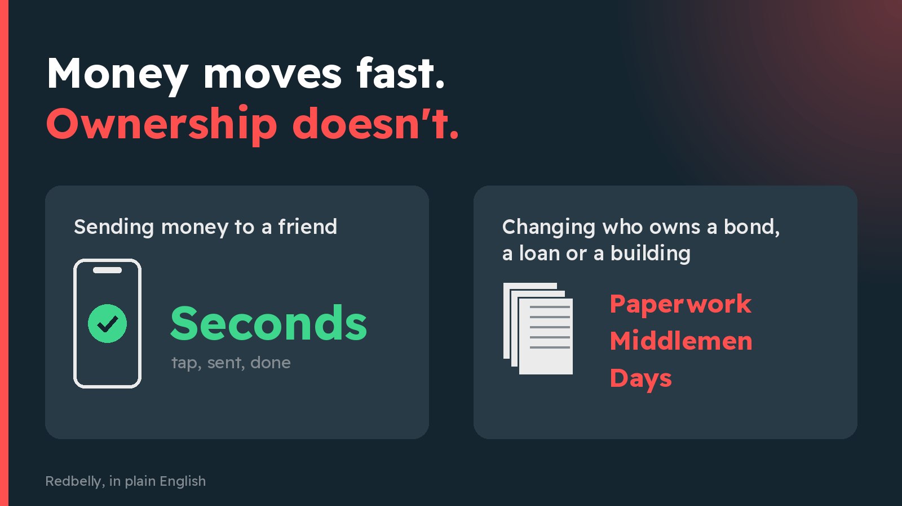
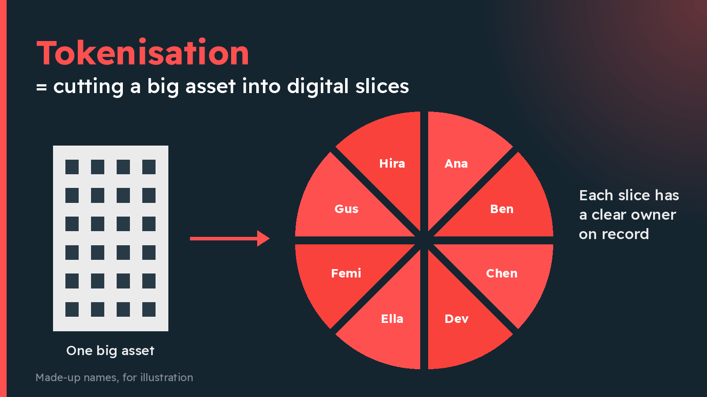
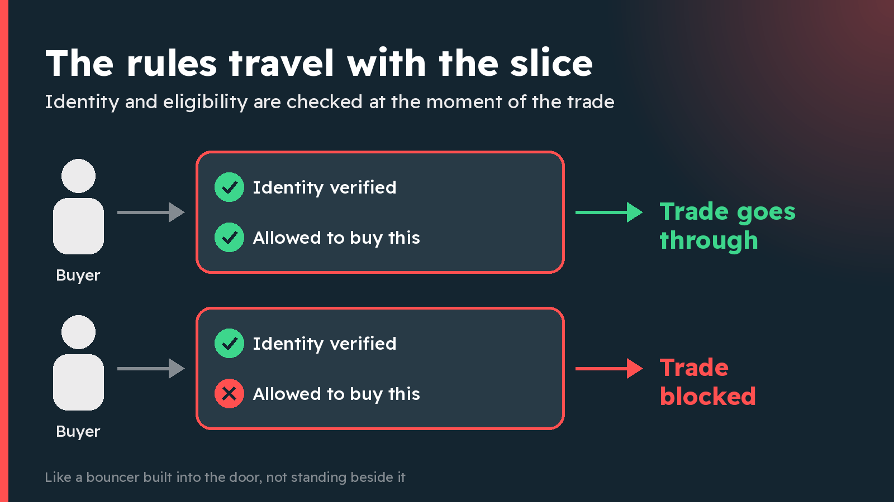
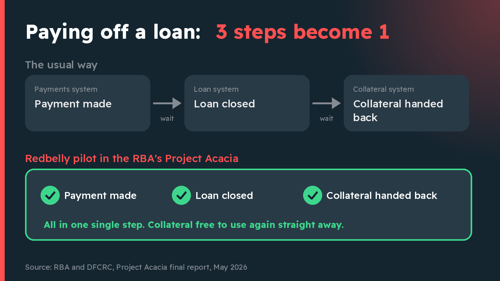
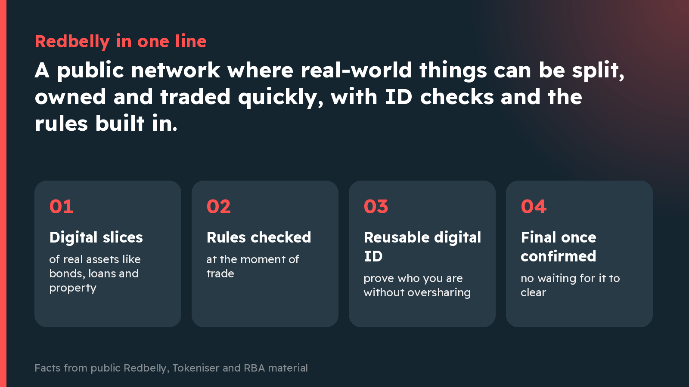

# Redbelly in plain English: an X thread

Format: X thread, 10 posts, 5 original images. Each post is under X's 280-character limit. Post them in order as one thread, attach each image to the post marked below, and paste the alt text into the image description.

## 1/10

```text
You can send money to a friend in seconds.

But changing who owns a bond, a business loan or a slice of a building? That still runs on paperwork, middlemen and "allow 3-5 business days".

Redbelly is an Australian network built to fix that. Plain-English thread 👇
```



**Attach:** `images/01-money-fast-ownership-slow.png`  
**Alt text:** Two cards side by side. Left card: 'Sending money to a friend' with the word 'Seconds'. Right card: 'Changing who owns a bond, a loan or a building' with the words 'Paperwork, middlemen, days'. Heading: 'Money moves fast. Ownership doesn't.'  
*264 / 280 characters*

## 2/10

```text
So what is Redbelly?

A public digital network for keeping track of who owns what, built for real-world things like bonds, loans, property and carbon credits.

Businesses, fund managers and investors all look at the same up-to-date record, instead of each keeping their own copy.
```

*279 / 280 characters*

## 3/10

```text
It wasn't dreamt up in a garage.

Redbelly grew out of research at the University of Sydney, working with CSIRO, Australia's national science agency.

Work started in 2016. The public network went live in November 2024.
```

*219 / 280 characters*

## 4/10

```text
The big idea has a clunky name: "tokenisation".

Plain version: picture a big asset (a building, a fund, a bundle of loans) as a pizza. 🍕

Redbelly lets the owner cut it into digital slices that can be issued, held and traded, each one with a clear owner on record.
```



**Attach:** `images/02-pizza-slices.png`  
**Alt text:** A building on the left, an arrow, then a pizza cut into eight slices on the right, each slice tagged with a different owner. Heading: 'Tokenisation = cutting a big asset into digital slices'.  
*266 / 280 characters*

## 5/10

```text
Here's what makes Redbelly different: the rules travel with the slice.

Many investments are only legally open to certain buyers. On Redbelly, identity and eligibility are checked at the exact moment of the trade.

Like a bouncer built into the door, not standing beside it.
```



**Attach:** `images/03-bouncer-in-the-door.png`  
**Alt text:** Two rows. Top row: a buyer passes two checks, 'Identity verified' and 'Allowed to buy this', and the trade goes through. Bottom row: a buyer fails the 'Allowed to buy this' check and the trade is blocked. Heading: 'The rules travel with the slice'.  
*274 / 280 characters*

## 6/10

```text
And you don't hand over your passport a hundred times.

Users are verified with a reusable digital ID, so they skip repeating the same checks on every platform.

Clever maths ("zero-knowledge proofs") lets you prove you passed the check without sharing all your personal details.
```

*279 / 280 characters*

## 7/10

```text
When a trade is done, it's done.

No "pending" for days. Once a transaction is confirmed on Redbelly, it's final and can't be reversed.

Think handing over cash, not waiting for a cheque to clear.
```

*196 / 280 characters*

## 8/10

```text
Has anyone serious tested it?

In Project Acacia, Australia's central bank (the RBA) tested digital money in these markets. Redbelly was one of only three networks used for the RBA's trial digital money.

In one pilot, a company bond was bought with that money, both on Redbelly.
```

*279 / 280 characters*

## 9/10

```text
Another pilot on Redbelly shows why it matters.

Paying off a loan usually takes 3 steps in separate systems: payment, loan closed, then the collateral (what backs the loan) handed back.

On Redbelly, all 3 happened in a single step, so the collateral was free again instantly.
```



**Attach:** `images/04-loan-three-steps-to-one.png`  
**Alt text:** Top half, 'The usual way': three separate boxes, 'Payment made', 'Loan closed', 'Collateral handed back', each in a different system with waiting in between. Bottom half, 'Redbelly pilot in the RBA's Project Acacia': one box doing all three at once. Heading: 'Paying off a loan: 3 steps become 1'.  
*277 / 280 characters*

## 10/10

```text
Why should you care? This is the plumbing behind money and ownership.

Redbelly in one line: real-world things split, owned and traded quickly, with ID checks and the rules built in.

Tokeniser, a platform built on Redbelly, reports A$1.2B issued for 160+ companies and funds.
```



**Attach:** `images/05-one-line-summary.png`  
**Alt text:** Summary card. 'Redbelly in one line: a public network where real-world things can be split, owned and traded quickly, with ID checks and the rules built in.' Four tiles: 'Digital slices of real assets', 'Rules checked at the moment of trade', 'Reusable, private digital ID', 'Final once confirmed'.  
*276 / 280 characters*

---

## Sources

- Redbelly Network home page: https://redbelly.network
- Redbelly About us and timeline: https://redbelly.network/about-us
- Redbelly asset tokenisation page: https://redbelly.network/asset-tokenisation
- Redbelly article: What sets Redbelly Network apart: https://redbelly.network/blog/what-sets-redbelly-network-apart
- Redbelly Project Acacia page: https://redbelly.network/projectacacia
- RBA and DFCRC, Project Acacia final report, May 2026: https://www.rba.gov.au/payments-and-infrastructure/central-bank-digital-currency/pdf/project-acacia-final-report.pdf
- RBA media release, 18 May 2026: https://www.rba.gov.au/media-releases/2026/mr-26-13.html
- Tokeniser home page: https://tokeniser.com

Sentence-by-sentence source mapping: `FACT_CHECK.md`. Full source notes: `SOURCES.md`.
